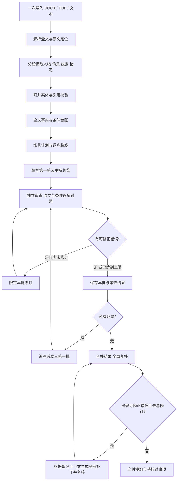

# 模组整理的两个模式

2026-10-12 按用户反馈简化：这是供 KP 参考的工具，不以模型反复审查通过作为使用门槛。

| 模式 | 内容 | 适用情况 |
| --- | --- | --- |
| 跑团辅助（默认） | 从原文提取委托与调查目标、人物、场景、地点、线索、检定及原有地图资料 | KP 已熟悉模组，需要查资料和操作跑团工具 |
| 主持参考 | 包含跑团辅助的全部结果，再补真相、开场、人物扮演、逐幕参考与主持建议 | KP 不熟悉模组，希望降低备团阅读成本 |

两种模式共用同一份结构化模组。基础模式解析完成即可检查、保存和带入房间；之后可以点击“补充主持参考”，基于原有资料和保留的原文继续，人物、场景、地图等不会重建或丢失。地图资料指原文已有的地图与图片附件，仍使用现有查看、关联和导入流程，不承诺从纯文字自动画出地图。

增强模式仍是多步工作流：解析 → 梳理全文事实与条件 → 规划各幕 → 分批生成参考并保存。默认不调用额外模型逐批审查、反复修订或总审；结构、引用和引文校验保留。原文依据、建议与不确定处明确区分，最后由 KP 调整和裁定。失败或停止保留已完成内容，补充参考失败也不妨碍使用基础资料。

界面只提供以上两个模式。下面记录的完整语义审查流程保留为开发诊断工具，需显式传入 `semanticReview: true`，不会从普通页面自动启动。此前质量报告描述的是该诊断流程，不能直接当成简化路径的新质量结论。

## 诊断流程设计与历史记录

## 目标与验收基准

用户已反馈《初次主持试阅—前三幕登场修订》“基本可以直接带”。该包包含人工修订，不能把它当作现有模型自动生成质量的证明。工作流的目标是把这些修订背后的判断固化，让一次导入自动完成提取、整理、核对与有限修订。

“一次生成”是一次用户操作、一个可恢复任务；内部包含多个各司其职的模型调用。用户不必修改提示词、逐幕点击或人工拼接多个结果。不会承诺任何输入都能生成正确答案：原文缺失、歧义和识别失败必须作为交付内容呈现，不能生成一个看似完整的错误模组。

验收基准是未读原文的 KP 只读“先读这页”和当前幕，能回答：

1. 谁在做什么，为什么做，不介入将发生什么？
2. 怎么把调查员带进来，第一句话怎么说，玩家当下知道什么？
3. 玩家最可能调查什么，直接获得什么，哪些需要检定，失败怎样继续？
4. 玩家跳过关键地点、逆序调查、怀疑委托人时有什么后果和接续办法？
5. 当前人物怎样演；什么能说、什么在隐瞒；什么称呼能公开？
6. 哪些时间、先决条件和结局条件不能改写；哪些是主持建议或原文疑点？

## 总体结构

每个节点有明确输入、固定输出结构和独立检查。后续节点能访问原文依据，不能只依赖上一层摘要，否则最早遗漏的条件会一路消失。

| 阶段 | 必须产出的内容 | 进入下一步的条件 |
| --- | --- | --- |
| 原文解析 | 规范化全文、文件哈希、段落定位、无法识别部分 | 不静默截断；图片型页面/表格提取缺失要显式报告 |
| 结构提取 | 场景、地点、人物、线索、检定、手札、关联及出处 | 结构合法，实体 ID 唯一，引用存在；各段都有已处理记录 |
| 全文台账 | 真相、路线前提、公开时机、检定条件、时间限制、相互矛盾的说法 | 每条有唯一编号；依据逐字匹配；不匹配的事实降为待核对 |
| 场景规划 | 每幕目的、所需条件编号、去向、逆序/跳过/失败的处理 | 每幕恰好一份计划；受影响的条件自动关联，模型不能悄悄漏掉 |
| 主持编写 | 总览、人物扮演、当前幕行动裁定、公开稿 | 每批只覆盖指定场景；原作事实、建议与疑点分开；不会自动发给玩家 |
| 独立审查 | 每个条件的覆盖判定、具体问题位置、原文依据、修正要求 | 台账逐条有结论；相关条件不能用“不适用”跳过；不接受只有总体评分 |
| 定点修订 | 仅包含待改字段的补丁 | 程序原子合并并校验，保留其余正文；重新审查；每批最多一次自动修订 |
| 整包复核 | 对实际合并结果的全局检查及最终问题清单 | 检查跨批一致性、整体路线与遗漏；有未解决问题就不能标成核对通过 |

全局审查有错误时，使用完整候选和全部问题清单生成一组局部补丁，再重新检查合并结果。补丁只输出改动，因而不再需要按原写作批次分别重写同一条全局规则。已有旧批次修订队列仍可恢复；新的整包修订、待审候选和进度一起持久化，恢复时不重复改写已完成的候选。保留的 KP 手工修改只核对，不由这一自动步骤覆盖。

结构提取的 world 和 evidence 两步可能为同一事物使用不同名称。归并必须同时采纳“场景指向线索”和“线索指向场景”的已解析关联；检定先使用本场已有的完整检定，不能因“心理学普通成功”与“心理学”文字不同就创建空检定。跨模组实测发现并修正了这两个问题。

## 中间资料是事实依据，不是另一篇摘要

当前第一版使用三类强类型中间产物：

- `KeeperEvidence.facts`：`id / category / sceneIds / note`。`note` 保留 `source / advice / uncertain` 与逐字引文；`sceneIds=[]` 表示全局条件。
- `KeeperPlan.scenes`：`sceneId / factIds / purpose / alternativeRoutes`。代码把所有全局条件和影响本幕的条件加入计划，防止规划时遗漏。
- `KeeperReview`：逐条件 `covered / issue / not-applicable`，以及具体 `field / severity / note` 问题。审查调用独立于写作，不继承写作者的对话推理。

例如“先去柳屋”不应仅出现于某个地点的摘要中。台账要记录其对祝福和幻境的影响，关联启幕和相关调查场景；场景计划据此要求写出“玩家坚持该路线时怎么带”；公开稿仍只呈现此刻能看到的内容。自动审查同时核对这三处。

对于扬屋，应分别表达会面时和失踪后的状态。玩家称呼、地点描述、发现条件都属于“某个场景和某个时刻下的公开版本”，不能直接复制实体的全局私密说明。同一线索的“询问即可获知”与“知识成功获知”必须是两个发现版本。

后续若要自动模拟复杂路线，可以把条件细化成 `requires / forbids / reveals / changes / leadsTo`，并为时间与状态提供明确值。但第一版不会把自然语言条件假装成可执行规则，更不会凭空推导原文未定义的行动后果。

## 主持稿的固定交付形态

“先读这页”包含真相因果、委托动机、不介入的发展、必须记住的限制、玩家车卡背景。人物卡包含当前目标、掌握的信息、隐瞒的内容、被追问时的反应与简短扮演提示。

每一幕依次提供：本幕作用、可直接朗读的开场、人物地点何时如何介绍、常见调查行动及裁定、发现后说给玩家的文案、可去的方向、容易卡住的地方。建议必须解释怎么做；“引导玩家继续调查”不算有效的失败接续。

公开文案独立存放。私密事实用于 KP 的理解和裁定；玩家只接收 KP 选中的版本与编辑后的文字。生成、采用草稿、向房间公开是不同操作。

## 检查责任

代码负责可确定的检查：结构、ID、缺幕、缺人物、缺登场稿、引用归属、引文匹配、逐条件审查覆盖、原文与草稿版本、修订次数、任务取消和恢复。模型负责需要理解的检查：因果、时间冲突、先后顺序、身份剧透、文字是否适用于当前情境、替代行动是否真的可带。

模型审查不能单独证明质量。“所有条件都有 covered”只是运行约束，仍须用固定缺陷样本验证审查是否真的发现了问题。人工试阅结果和自动核对状态分开记录。

原文矛盾需要：保留两边依据、解释主持时哪里会受影响、提出明确标为建议的处理选项。不得为了让检查变绿而删除矛盾的一边。缺少全文时只能给“依据现有摘录核对”的结果。

## 一次任务、恢复与成本

每个阶段成功后保存中间结果；写作完成但审查失败时，保留待审草稿，下次从审查继续。第一幕经过本批检查后可先读，后续继续生成。用户点击停止会取消当前模型请求，之前的结果保留。

缓存身份包括工作流版本、输入内容哈希、提供者和模型；检查点另记录正文哈希。原文、模型或正文改变时，旧待审草稿不能直接覆盖新内容。手工修改的参考保留并重新核对。最终结果带工作流版本及审查信息，导出再导入仍能识别其来源和是否过期。

提供者异常不算质量修订，不以捏造的替代内容填空；失败节点保留，用户可以恢复。结构错误、截断或空响应最多在当前节点自动重试一次；取消和其他错误不会自动重试。一次任务允许每批一次语义修订，以及总审后的一次整包补丁，避免无限自我修正。对于 B 个写作批次，主持整理基础调用为 2 次台账/规划、2B 次写作/审查、1 次总审，即 2B+3；每个需要修订的批次增加 2 次，总审补丁与两次复核另增 3 次，另加缺项补写和格式重试调用。结构提取调用单独计算，不能把该数当整次导入费用。

总审补丁同时看到总览与各幕，修订前后都能检查同一条件的所有出现位置，不会丢掉后期场景修订中同步修改的总览。中断后继续当前队列。已经结束为“待核对”的任务再次由用户启动时，可以获得新的一轮有限修订，不会只重复审查而永远无法改正文；旧总审问题会带入复核。手写正文仍保留，不自动覆盖。

台账同样可能误读原文。审查允许对现有事实 ID 给出带逐字依据的更正，程序先更新台账，再独立复核正文，避免写作者被错误台账反复拉回。更正不能删除事实 ID，也不能用建议冒充原文。每次审查最多追加一次台账更正后的复核；这部分调用应另计。

网页安全桥在已验证请求等待模型时发送固定进度心跳，避免超过五分钟仍没有响应头而出现 `Failed to fetch`。心跳不延长后台执行期限，不提前交付模型输出；输出仍需唯一终态校验。

长篇原文最终需要“分章台账 + 全文约束归并 + 带邻接条件的场景上下文”。当前第一版仍受每次 300,000 字符输入容量约束，超过时明确停在可恢复点，不会偷偷丢掉后半本。长篇分章处理是后续工程范围，不能把当前版本宣称为任意长度支持。

## 质量回归与上线条件

以用户认可的试阅包作为人工参考答案，同时保留原始模型输出作为缺陷样本。验收不能只检查关键词或 JSON 合法性。

| 缺陷样本 | 必须观察到的结果 |
| --- | --- |
| 删除逆序调查的祝福/幻境限制 | 审查指出缺失位置，修订补回原作后果 |
| 将失踪后现场写入初见地点公开稿 | 报时序剧透，开场稿只保留当前状态 |
| 把未登场或仅被提及的 NPC 放在现场 | 修正为转述或暂不公开 |
| 用真名替换玩家尚不知道的称呼 | 指出身份泄露，恢复当前可知称呼 |
| 把直接询问与成功检定的发现合并 | 恢复两个独立版本及各自条件 |
| 给原本互相矛盾的时限一个确定结论 | 明确保留歧义、双方引文与主持选择 |
| 模型给出不存在的 ID 或伪造引文 | 硬校验失败或事实降为待核对，不能默默通过 |
| 写完一批后中断、修改原文再恢复 | 未改输入只接着审查；输入已改不套用旧待审结果 |

先对《见世之蝶》做端到端验证，再加入至少两份不同结构的模组（线性调查与开放地点调查），每份独立生成多轮。记录上述关键错误、人工修改数、能否只读引导开团、首幕/整包耗时及实际用量。只有自动产物无需人工补关键条件且经未读原文者验收，才可声称稳定接近试阅包质量。

可复现的内容验收入口：

- `apps/desktop/src/test/scenarios/keeper-quality/acceptance.json`：27 个有原作答案的实际主持问题。问题涉及真相、现场朗读、逆序调查、失败接续、发现门槛、身份、时间变化及结局。验收看答案是否足以裁定，不看 JSON 栏目是否齐全。
- `scripts/evaluate-keeper-quality.py`：独立读者只收到生成参考正文和问题，收不到模组原文、条件台账和标准答案；另一轮调用依据标准答案判定，且核对读者所引正文确实存在。它是自动阅读模拟，不是假称人类盲测。
- `--opening-only` 进一步限制读者只能读“先读这页”和启幕，检查真相、开场、逆序调查、知识失败和心理学裁定。不能用完整资料里另一个角落的答案代替开场引导。`--case` 用于保留为独立报告的单题追问；它不会覆盖整轮失败记录。
- `scripts/validate-keeper-mutations.py`：保持输出结构合法，故意注入五类剧情错误，实际调用产品的审查步骤，再人工核对报告是否抓到了对应缺陷。
- `last-train.md` 与 `tide-ledger.md`：原创受控测试模组，分别包含明确倒计时/多种解法、自由调查/状态变化/原文时间冲突。不是第三方正式模组或已经人类实跑过的样本。
- `scripts/validate-keeper-source.py` 与 `KeeperWorkflowLive.test.ts`：实际调用原文提取与主持流程，保存每步输入、模型输出、耗时和可恢复成品。无 mock 生成文本，也不写入用户模组库。
- `scripts/summarize-keeper-quality.py`：汇总所有保留的运行及验收尝试，区分未完成的诊断运行、生成完成、语义通过和原文疑点。累计调用耗时不包含已取消或失败的调用，不能当作实际费用；原文提取与主持整理也要分别计时。

## 本次实现边界

现有 Python 结构提取已包含 normalize → segment → extract → resolve_references → validate → summarize；Codex 的分段提取另分 world/evidence 两个缓存阶段。沿用其结构提取和引用归并，不添加第二套实体格式。

本次新增的是结构提取后的全文台账、逐幕规划、独立审查、有限修订、合并总审，以及持久化和页面状态；网页、桌面和 DeepSeek 直连使用同一组固定阶段协议。一次“开始整理模组”会自动进入该链路。

尚未实现：根据语义审查结果自动返回结构提取节点补建漏掉的实体/场景、任意长篇的分章约束归并、可执行的路线条件系统，以及跨模组多轮人工质量评测。这些限制须保留在交付说明中；第一版工作流的存在不等于稳定质量已经得到证明。

### 首轮实测记录（2026-10-12）

使用原模组全文及已提取的启幕实体作真实 Codex 步骤测试，不写入用户模组库。事实台账 265 秒、场景计划 37 秒、主持草稿 256 秒、独立审查 79 秒。台账产生 89 条事实与条件，自动保留“先去柳屋”的祝福/幻境限制，以及湖畔月亮升起与截止时间的疑点；开场稿未混入失踪后的现场状态。这些是部分阶段的观察，不能作为整本模组质量或稳定耗时结论。

首轮试跑暴露了程序把未指定场景的条件都强行视为本批必写项的误报。旧规则触发不必要的修订；该修订在 300 秒后因 `preparation.essentials` 超过 12 条被结构校验拒绝。这是本轮继续验证之前的历史状态。后续实测记录、原始失败和最终结果见 [内容验证记录](module-generation-validation.md)。

修订现在返回受限的 `replace/add/remove` 补丁，路径以本批 `candidate.preparation` 为根。程序禁止替换整个场景、人物表或实体 ID；逐项合并后重新检查结构、引用、引文和登场版本完整性。失败时整份补丁不落盘，原稿保留，并允许一次带具体错误位置的格式重试。审查仍针对合并后的实际全文。已有的旧 `repair` 协议保留兼容，但新的工作流使用 `patch`。
